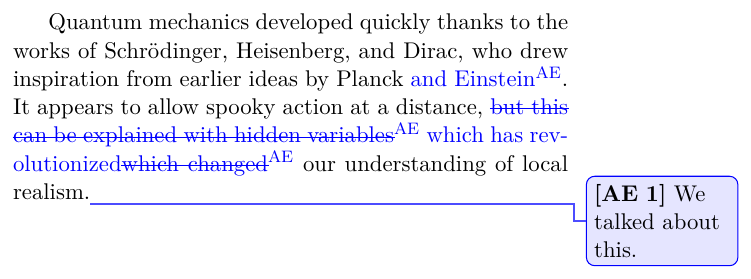

# How to track changes by several authors

## Context and Problem Statement

When several people write a paper, or a supervisor reviews a thesis, additions, removals and remarks have to be visible in the PDF and attributable to their author, and they have to disappear for the final version.
How to track changes by several authors in LaTeX?

Sources and images are in [change-tracking/](change-tracking/).

## Considered Options

- [phfcc](https://ctan.org/pkg/phfcc)
- [changes](https://ctan.org/pkg/changes)
- [todonotes](https://ctan.org/pkg/todonotes)
- [latexdiff](https://ctan.org/pkg/latexdiff)
- [trackchanges](https://ctan.org/pkg/trackchanges)

## Pros and Cons of the Options

### phfcc

- Good, because one command per author covers everything: `\AlE{added}`, `\AlE*{removed}`, `\AlE[comment]`, `\AlE!{important}`.
- Good, because the initials are set once per page in the margin, so the text is not cluttered.
- Good, because `\phfDisableCommentingCommands` turns all marks off for the final version, and the `footcomments` style moves comments into footnotes to keep the layout intact.
- Good, because removed text is struck through across line breaks with LuaLaTeX (`rmstrikethrough` style, via lua-ul).
- Bad, because there is no list of all changes.

### changes

- Good, because `\added`, `\deleted`, `\replaced`, `\highlight` and `\comment` are explicit, and `\listofchanges` lists them.
- Good, because the `final` option removes all marks and a script (`pyMergeChanges.py`) applies them to the source.
- Bad, because every mark carries the author as `[id=...]` and a superscript marker, which clutters the text.
- Bad, because `\comment` clashes with other packages that define `\comment` (verbatim, mindflow).

### todonotes

- Good, because it is already there for TODOs.
- Bad, because it only places notes; additions and removals have to be marked by hand.

### latexdiff

- Good, because it compares two versions of the source and marks every difference, with nothing to write in the text.
- Bad, because it needs two complete versions and a Perl run; it is a diff, not a conversation between authors.

### trackchanges

- Bad, because it is not part of TeX Live.
