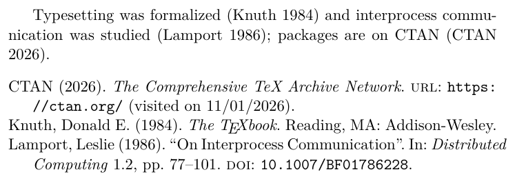
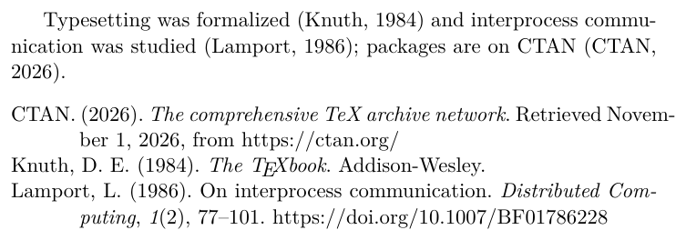
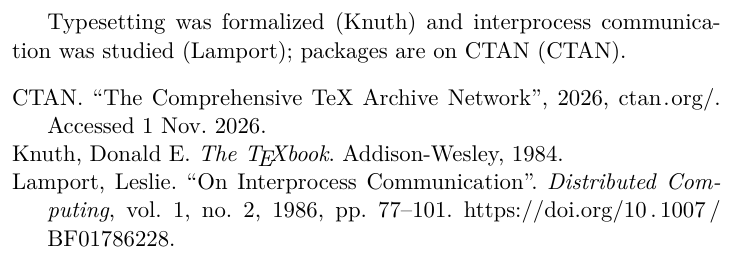
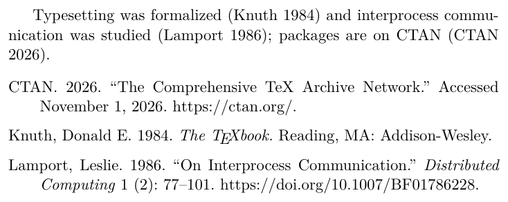
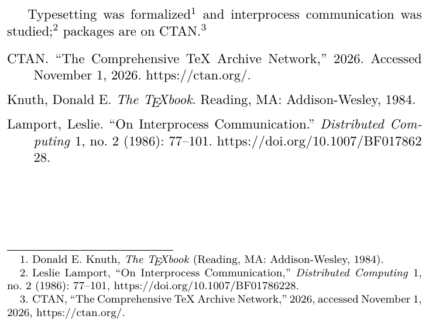
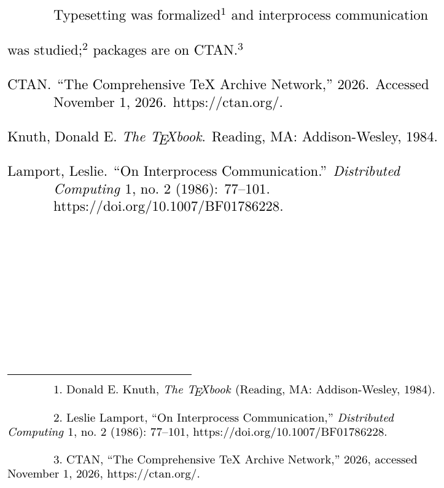
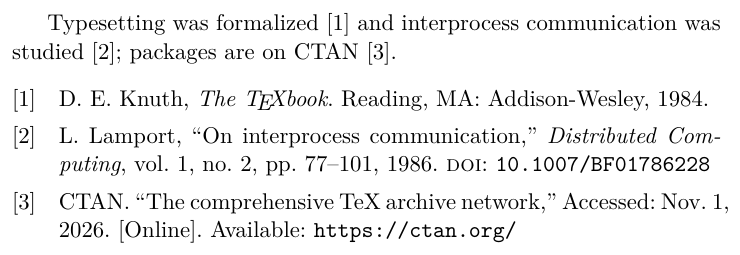

# How to cite in a given citation style

## Context and Problem Statement

A department, journal or supervisor prescribes a citation style: APA, MLA, Chicago, Turabian or IEEE.
The style fixes how a citation looks in the text (author-year, author-page, footnote or number) and how the bibliography entries are formatted.
How to typeset citations and the bibliography in a prescribed style?

The [citation help of the University of Pittsburgh Library](https://pitt.libguides.com/citationhelp) explains each style with examples; the sections below link the page of each style.

## Considered Options

- [`biblatex`](https://ctan.org/pkg/biblatex) with its built-in styles `authoryear` and `numeric`
- [`biblatex-apa`](https://ctan.org/pkg/biblatex-apa) for [APA 7th edition](https://pitt.libguides.com/citationhelp/apa7)
- [`biblatex-mla`](https://ctan.org/pkg/biblatex-mla) for [MLA 9th edition](https://pitt.libguides.com/citationhelp/mla9thedition)
- [`biblatex-chicago`](https://ctan.org/pkg/biblatex-chicago) for [Chicago](https://pitt.libguides.com/citationhelp/chicago), author-date or notes
- [`turabian-formatting`](https://ctan.org/pkg/turabian-formatting) for [Turabian 9th edition](https://pitt.libguides.com/citationhelp/turabian)
- [`biblatex-ieee`](https://ctan.org/pkg/biblatex-ieee) for [IEEE](https://pitt.libguides.com/citationhelp/ieee)
- BibTeX styles (`.bst` files) such as [`apacite`](https://ctan.org/pkg/apacite) or `IEEEtran.bst`

Sources and images are in [citation-styles/](citation-styles/); all examples cite the same [references.bib](citation-styles/references.bib) with `\autocite`, so switching the style is one line in the preamble.

## Pros and Cons of the Options

### `biblatex` with `authoryear` or `numeric`

Source: [biblatex-authoryear.tex](citation-styles/biblatex-authoryear.tex)

- Good, because no additional package is needed and both looks (author-year, number) are available with `style=authoryear` or `style=numeric`.
- Good, because the styles are generic and configurable (`maxnames`, `giveninits`, `doi`, `url`, ...).
- Bad, because they follow no published style guide: "(visited on 11/01/2026)" and "1.2, pp. 77--101" are `biblatex`'s own conventions, which a department prescribing APA or Chicago does not accept.

### `biblatex-apa`

Source: [biblatex-apa.tex](citation-styles/biblatex-apa.tex)

- Good, because it implements the 7th edition of the APA Publication Manual, the style most often prescribed in psychology, education and the social sciences.
- Good, because `\autocite` gives "(Knuth, 1984)", `\textcite` gives "Knuth (1984)", and the bibliography is sorted and hanging-indented as APA wants.
- Good, because the author maintains it closely in step with `biblatex` and `biber`.
- Bad, because it needs `biber`; BibTeX cannot process it.

### `biblatex-mla`

Source: [biblatex-mla.tex](citation-styles/biblatex-mla.tex)

- Good, because it implements MLA 9th edition (`style=mla`); the 7th edition is available as `style=mla7`.
- Good, because citations are author-page as MLA wants: `\autocite[12]{knuth1984}` gives "(Knuth 12)".
- Bad, because MLA is used in the humanities (literature, languages), not in engineering or the sciences.

### `biblatex-chicago`

Author-date:

Source: [biblatex-chicago-authordate.tex](citation-styles/biblatex-chicago-authordate.tex)

Notes:

Source: [biblatex-chicago-notes.tex](citation-styles/biblatex-chicago-notes.tex)

- Good, because the package is loaded instead of `biblatex` (`\usepackage[authordate]{biblatex-chicago}` or `[notes]`) and `\autocite` then gives either "(Knuth 1984)" or a footnote with the full reference on first citation and a short form afterwards.
- Good, because both Chicago systems are covered: author-date (sciences, social sciences) and notes-bibliography (humanities).
- Good, because the implementation is complete and well documented (the manual is over 100 pages) and handles the many entry types of the Chicago Manual.
- Bad, because the package in TeX Live 2026 (version 2.3b) implements the 17th edition; the 18th edition (2024) is not covered yet.
- Bad, because the notes system needs footnotes, which changes the writing: every citation is a footnote and `\autocite` goes after the punctuation.

### `turabian-formatting`

Source: [turabian-formatting.tex](citation-styles/turabian-formatting.tex)

- Good, because Turabian is Chicago for students (same citation rules) and the package adds the page layout of the 9th edition of Turabian's manual: double spacing, indented footnotes, title page, with the classes `turabian-researchpaper` and `turabian-thesis`.
- Good, because citations come from `biblatex-chicago`, so switching between notes and author-date is the same option.
- Bad, because the layout is fixed by the class (double-spaced, one-column), which collides with any other thesis or paper layout; the package is for documents that have to follow Turabian in full.

### `biblatex-ieee`

Source: [biblatex-ieee.tex](citation-styles/biblatex-ieee.tex)

- Good, because `style=ieee` gives numbered citations "[1]" and the bibliography of the IEEE Reference Guide, with `biblatex`'s flexibility (`\textcite`, `\citeauthor`, back references).
- Good, because it is maintained by the author of `siunitx`.
- Bad, because the IEEE class `IEEEtran` expects BibTeX with `IEEEtran.bst`; a paper submitted to IEEE has to use that, and `biblatex-ieee` is for documents that want the IEEE look elsewhere (e.g., a thesis).

### BibTeX styles

- Good, because `apacite`, `IEEEtran.bst`, `splncs04.bst` and `ACM-Reference-Format.bst` are what the respective publishers ship and expect, and they work with plain BibTeX.
- Good, because they work with `natbib`, which many classes (`IEEEtran`, `acmart`, `llncs`) load themselves.
- Bad, because a BibTeX style is a program in a stack language of its own: adapting one (a changed field order, a localized "and") is hard, while a `biblatex` style is LaTeX.
- Bad, because BibTeX does not handle UTF-8, sorting of non-ASCII names, or `@online` entries with access dates well; `biber` does.
