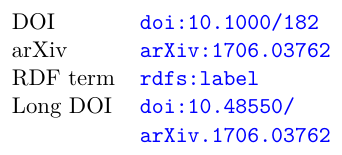
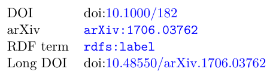
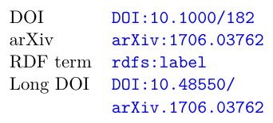
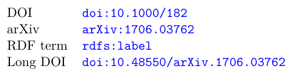

# How to link identifiers and prefixed names

## Context and Problem Statement

A text often refers to a resource by a short identifier instead of a full URL: a DOI, an arXiv number, or a prefixed name of the Semantic Web such as `rdfs:label`.
The reader should see the short form, and a click should open the full URL, such as `https://doi.org/10.1000/182` or `http://www.w3.org/2000/01/rdf-schema#label`.
How to typeset and link short identifiers?

All examples set the same four identifiers, the last one in a column too narrow for it, and color the links blue.
Sources and images are in [identifier-links/](identifier-links/).
Identifiers in the bibliography are out of scope: `biblatex` links its `doi` and `eprint` fields itself.

## Considered Options

- `\href` of [`hyperref`](https://ctan.org/pkg/hyperref) with own macros
- [`doi`](https://ctan.org/pkg/doi)
- [`uri`](https://ctan.org/pkg/uri)
- [`aurl`](https://ctan.org/pkg/aurl)

## Pros and Cons of the Options

### `\href` with own macros



Source: [hyperref.tex](identifier-links/hyperref.tex)

```latex
\newcommand{\doi}[1]{\href{https://doi.org/#1}{\nolinkurl{doi:#1}}}
```

- Good, because one `\newcommand` per kind of identifier sets both the displayed text and the target, so any resolver and any prefix work.
- Good, because `\nolinkurl` breaks a long identifier like `\url` does.
- Good, because it needs no package beyond `hyperref`.
- Bad, because every document defines its own macros, and a `#` in the target has to be written as `\#`.

### `doi`



Source: [doi.tex](identifier-links/doi.tex)

- Good, because `\doi{10.1000/182}` links to `https://doi.org/10.1000/182`; `\doiurl` changes the resolver.
- Good, because a DOI with an underscore (`\doi{10.1007/978-3-030-58920-2_13}`) works.
- Bad, because it covers DOIs only.
- Bad, because the DOI is set in the text font and does not break: a long DOI runs into the margin.
- Bad, because the link covers only the number, not the prefix `doi:`.

### `uri`



Source: [uri.tex](identifier-links/uri.tex)

- Good, because one package links eleven kinds of identifiers: `\arxiv`, `\asin`, `\doi`, `\hdl`, `\nbn`, `\oclc`, `\oid`, `\pubmed`, `\tinyuri`, `\tinypuri`, `\wc`; plus `\mailto` and `\citeurl`.
- Good, because it builds on `url`: identifiers with special characters (`\arxiv{hep-th/9901001}`, an underscore, a SICI DOI with `<`, `;` and parentheses) work and break across lines.
- Good, because the displayed prefix is an option per kind, for example `\usepackage[doipre={doi:}]{uri}` instead of the default `DOI:`.
- Bad, because it has to be loaded after `hyperref`; loaded before, it sets the identifiers without links and without a warning.
- Bad, because `\doi` links to the old resolver `https://dx.doi.org/`, which still redirects to `https://doi.org/`.
- Bad, because the list of kinds is fixed; other identifiers, such as the RDF term, need `\uref{<target>}{<text>}`.
- Bad, because the last release is from 2018.

### `aurl`



Source: [aurl.tex](identifier-links/aurl.tex)

- Good, because `\aurl{rdfs}{label}` links prefixed names of the Semantic Web; the 100 most common prefixes are predefined, `\usepackage[1000]{aurl}` loads 1000.
- Good, because `\daurl{<prefix>}{<expansion>}` adds any prefix, so `\daurl{doi}{https://doi.org/}` makes it work for DOIs as well.
- Good, because an unknown prefix stops the compilation with `Undefined control sequence` instead of producing a broken link.
- Bad, because the suffix is set with `\texttt`: an underscore (`\aurl{dbr}{Albert_Einstein}`) causes `Missing $ inserted`, and a long name does not break and runs into the margin.
- Bad, because it loads `hyperref` itself; loaded before `\usepackage[<options>]{hyperref}`, it causes `Option clash for package hyperref`.
- Bad, because the predefined expansions date from 2016 and use `http://` where the vocabulary has moved to `https://` (`schema` expands to `http://schema.org/`).

## More Information

`uri` and `aurl` define no common commands and can be combined: `uri` for DOIs and arXiv numbers, `aurl` for RDF terms.
`uri` then warns `Packages uri AND aurl detected`; the warning is harmless.
The breaking of long URLs in general is discussed in [How to break long URLs](url-line-breaks.md).
