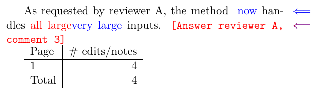
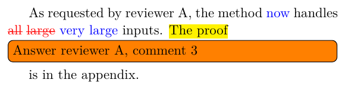
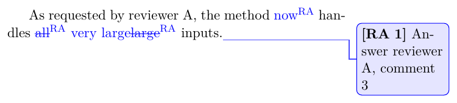

# How to mark the changes of a revised manuscript

## Context and Problem Statement

After the peer review of a journal or conference submission, the authors revise the manuscript and resubmit it.
The editor and the reviewers expect a version in which the changes are marked, often per reviewer, and a clean version without marks; the response letter points to the pages where each change is.
How to mark the changes of a revised manuscript in LaTeX?

Sources and images are in [journal-revisions/](journal-revisions/).
For notes between co-authors while writing, see [How to track changes by several authors](change-tracking.md).

## Considered Options

- [`ezedits`](https://ctan.org/pkg/ezedits)
- [`easyreview`](https://ctan.org/pkg/easyreview)
- [`changes`](https://ctan.org/pkg/changes)
- [`latexdiff`](https://ctan.org/pkg/latexdiff)

## Pros and Cons of the Options

### `ezedits`

Source: [ezedits.tex](journal-revisions/ezedits.tex)

- Good, because `\defineEdit{RA}{...}{...}` creates commands per reviewer (`\RAIns`, `\RADel`, `\RAEdit`), each with its own style, so the changes for each reviewer are distinguishable.
- Good, because the `accept` option typesets the revised text without marks: the clean version comes from the same source.
- Good, because `\makeeditreport` prints a table of the number of edits per page, which helps writing the response letter, and the `arrows` option points to each edit from the margin.
- Good, because the `pdfcomment` option writes the edits as PDF annotations instead.
- Bad, because a deletion that spans several paragraphs has to be split into one command per paragraph, and struck-out citations do not break across lines.
- Bad, because the page numbers in the report can be wrong for edits in floats.

### `easyreview`

Source: [easyreview.tex](journal-revisions/easyreview.tex)

- Good, because the commands are short and obvious: `\add`, `\remove`, `\replace`, `\highlight`, `\alert`, and `\comment`.
- Bad, because `\setreviewsoff` typesets the *original* text (removed text stays, added text too), not the revised one, so there is no clean revised version.
- Bad, because the changes are not attributed to a reviewer, and `\comment` (via `todonotes`) clashes with other packages that define `\comment`.
- Bad, because the last release is from 2015.

### `changes`

Source: [changes.tex](journal-revisions/changes.tex)

- Good, because `\added`, `\deleted`, and `\replaced` take the reviewer as `[id=...]`, and `\listofchanges` lists all changes with their pages for the response letter.
- Good, because the `final` option typesets the revised text without marks, and `pyMergeChanges.py` applies the changes to the source.
- Bad, because every mark carries the ID as a superscript, which clutters the text.
- Bad, because `\comment` clashes with other packages that define `\comment` (`verbatim`, `mindflow`).

### `latexdiff`

- Good, because it compares the submitted and the revised source and marks every difference, without any markup in the text; many journals ask for exactly this.
- Good, because the revised source stays clean.
- Bad, because changes are not attributed to reviewers.
- Bad, because it needs both versions and a Perl run, and it can produce a document that does not compile around changed tables, math, or custom macros.
