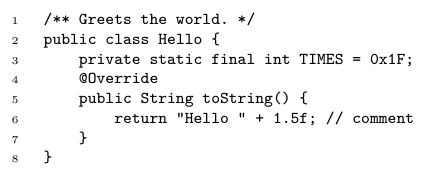
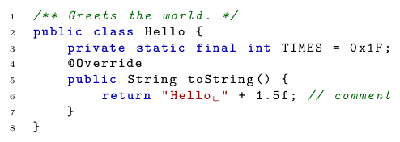
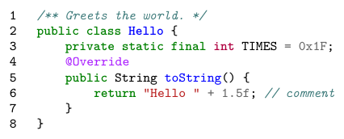
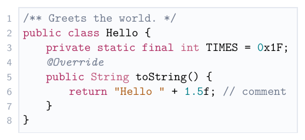
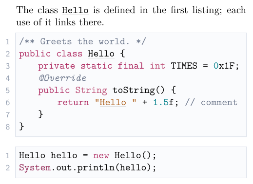

# How to typeset source code

## Context and Problem Statement

Documents need to show source code and terminal transcripts with syntax
highlighting, line numbers, and correct handling of special characters.
Which package should typeset code listings?

All examples set the same Java class with each package's default style.
Sources and images are in [source-code-listings/](source-code-listings/).

## Considered Options

- [`fancyvrb`](https://ctan.org/pkg/fancyvrb) (verbatim only, no highlighting)
- [`listings`](https://ctan.org/pkg/listings)
- [`minted`](https://ctan.org/pkg/minted)
- [`xlistings`](https://ctan.org/pkg/xlistings) (extends `listings`)

## Pros and Cons of the Options

### `fancyvrb`

Source: [`fancyvrb.tex`](source-code-listings/fancyvrb.tex)

- Good, because it is the lightweight choice when no highlighting is needed — faithful verbatim with framing and line numbers.
- Bad, because it does no syntax highlighting at all.

### `listings`

Source: [`listings.tex`](source-code-listings/listings.tex)

- Good, because it is pure LaTeX — no external tools, no `--shell-escape`, works on any TeX Live and on Overleaf out of the box.
- Good, because it is fast and self-contained.
- Bad, because its highlighting is keyword-based and less accurate than a real lexer, with dated defaults (e.g., `␣` for spaces in strings).
- Bad, because UTF-8 and some languages need extra configuration.

### `minted`

Source: [`minted.tex`](source-code-listings/minted.tex)

- Good, because it uses [Pygments](https://pygments.org/) for accurate, up-to-date highlighting across hundreds of languages: it knows annotations, class and method names, and the parts of an f-string.
- Good, because output looks modern with little configuration.
- Bad, because it requires Python; since minted 3 (TeX Live 2024), its helper `latexminted` runs with the restricted shell escape that TeX Live enables by default, older versions need `--shell-escape`.
- Bad, because it slows compilation (an external process per listing, cached between runs).

### `xlistings`

Source: [`xlistings.tex`](source-code-listings/xlistings.tex)

- Good, because it improves `listings` without any external tool: numbers are highlighted including hexadecimal literals, exponents, and type suffixes (`0x1F`, `1.5f`), and types such as `String` are colored.
- Good, because it provides a `minted` environment (option `fakeminted`, on by default), so `\begin{minted}{java}` documents compile without Python.
- Good, because line numbers are excluded from copying (`accsupp`), and listings get a light background box.
- Bad, because the `minted` environment is not a drop-in replacement: its options are `listings` keys (`numbers=left` instead of `linenos`, `escapeinside={|}{|}` instead of `escapeinside=||`), and `\setminted`, `\usemintedstyle`, `\inputminted`, and the `listing` float are missing.
- Bad, because it defines 24 languages (no BibTeX, for example), and its highlighting stays keyword-based: the inside of a Python f-string is a plain string.
- Bad, because it is new (version 1.0.0 of 2026-08, 1.1.1 of 2026-11 in TeX Live 2026): a language that the `minted` environment loads on first use loses some of its macros, so Java and YAML need `\LoadLanguages{java,yaml}` in the preamble ([issue 15](https://github.com/EagleoutIce/xlistings/issues/15)).

## More Information

### Linking identifiers in listings: [`code-link`](https://ctan.org/pkg/code-link)

Source: [`code-link.tex`](source-code-listings/code-link.tex)

`code-link` is a companion of `xlistings` by the same author and works with `listings`, `xlistings`, and `minted`.
`\CodeLinkAnchor{Hello}` marks a definition (inside a listing through `escapeinside`), and every later occurrence of `Hello` in a listing becomes a link to it; `\CodeLinkRef{Hello}` links from the text.
It matches the name also inside string literals (`"Hello "` in line 6).
It suits documents with many listings that refer to each other, such as theses on software.
Version 1.1.0 is from 2026-11: it is in an updated TeX Live 2026, but not on Overleaf, which keeps the snapshot of a TeX Live year.
