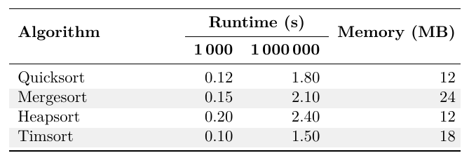
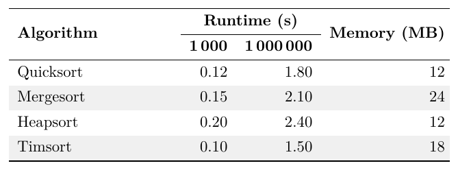
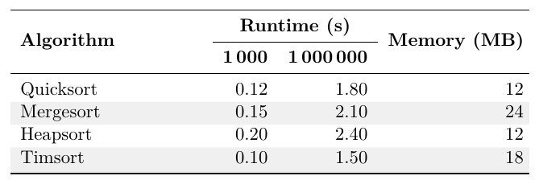

# How to lay out complex tables

## Context and Problem Statement

A table in a thesis often needs more than rows and columns of equal width:
header cells that span several rows or columns, columns that share the remaining line width, and colored rows that guide the eye.
With plain `tabular`, each of these needs its own package and its own commands inside the rows.
How to set column widths, spanning cells, and row colors of a table?

All examples set the same table: two header rows, a header cell that spans two columns, two that span two rows, and every second row on a gray background.
Sources and images are in [table-layout/](table-layout/).

## Considered Options

- `tabular` with [`tabularx`](https://ctan.org/pkg/tabularx), [`multirow`](https://ctan.org/pkg/multirow), and [`colortbl`](https://ctan.org/pkg/colortbl)
- [`tabularray`](https://ctan.org/pkg/tabularray)
- [`nicematrix`](https://ctan.org/pkg/nicematrix)

## Pros and Cons of the Options

### `tabular` with `tabularx`, `multirow`, and `colortbl`



```latex
\usepackage{tabularx,multirow}
\usepackage[table]{xcolor} % loads colortbl

\begin{tabularx}{\linewidth}{Xrrr}
  \toprule
  \multirow{2}{*}{\textbf{Algorithm}} & \multicolumn{2}{c}{\textbf{Runtime (s)}} & \multirow{2}{*}{\textbf{Memory (MB)}} \\
  \cmidrule{2-3}
                     & \textbf{1\,000} & \textbf{1\,000\,000} &    \\
  \midrule
  Quicksort          & 0.12            & 1.80                 & 12 \\
  \rowcolor{black!6}
  Mergesort          & 0.15            & 2.10                 & 24 \\
  Heapsort           & 0.20            & 2.40                 & 12 \\
  \rowcolor{black!6}
  Timsort            & 0.10            & 1.50                 & 18 \\
  \bottomrule
\end{tabularx}
```

Source: [tabular.tex](table-layout/tabular.tex)

- Good, because it is the classic approach: every LaTeX tutorial and most existing tables use it.
- Good, because `booktabs` rules work without any adaptation.
- Bad, because layout and content are mixed: `\multicolumn`, `\multirow`, and `\rowcolor` stand in the rows, so changing the layout means editing many rows.
- Bad, because the packages interact in fragile ways, e.g., a `\multirow` cell in a colored row is covered by the color of the next row.

### `tabularray`



```latex
\usepackage{xcolor} % for the row colors
\usepackage{tabularray}
\UseTblrLibrary{booktabs}

\begin{tblr}{
    colspec = {X[l] Q[r] Q[r] Q[r]},
    row{1,2} = {font=\bfseries},
    cell{1}{1} = {r=2}{l,m},
    cell{1}{2} = {c=2}{c},
    cell{1}{4} = {r=2}{r,m},
    row{4,6} = {bg=black!6},
  }
  \toprule
  Algorithm & Runtime (s) &                   & Memory (MB) \\
  \cmidrule{2-3}
            & 1\,000      & 1\,000\,000       &             \\
  \midrule
  Quicksort & 0.12        & 1.80              & 12          \\
  Mergesort & 0.15        & 2.10              & 24          \\
  Heapsort  & 0.20        & 2.40              & 12          \\
  Timsort   & 0.10        & 1.50              & 18          \\
  \bottomrule
\end{tblr}
```

Source: [tabularray.tex](table-layout/tabularray.tex)

- Good, because the layout is given once as key-value list in front of the content: `colspec` for the columns, `row{...}` for whole rows, and `cell{r}{c} = {r=2, c=3}` for spanning cells.
- Good, because `X` columns share the remaining width as in `tabularx`, and `longtblr` breaks a table across pages with the same keys.
- Good, because `\UseTblrLibrary{booktabs}` provides `\toprule`, `\midrule`, `\cmidrule`, and `\bottomrule` inside the table.
- Bad, because it compiles noticeably slower than `tabular`, as it measures every cell several times.
- Bad, because its default row spacing is larger than that of `tabular`, so the same table becomes taller (`rowsep` changes it).
- Bad, because commands inside cells that are not robust may need to be protected or wrapped in braces.

### `nicematrix`



```latex
\usepackage{nicematrix}

\begin{NiceTabular}[width=\linewidth]{X[l]rrr}[code-before = \rowcolor{black!6}{4,6}]
  \toprule
  \Block[l]{2-1}{\textbf{Algorithm}} & \Block{1-2}{\textbf{Runtime (s)}} & & \Block[r]{2-1}{\textbf{Memory (MB)}} \\
  \cmidrule{2-3}
            & \textbf{1\,000} & \textbf{1\,000\,000} &    \\
  \midrule
  Quicksort & 0.12            & 1.80                 & 12 \\
  Mergesort & 0.15            & 2.10                 & 24 \\
  Heapsort  & 0.20            & 2.40                 & 12 \\
  Timsort   & 0.10            & 1.50                 & 18 \\
  \bottomrule
\end{NiceTabular}
```

Source: [nicematrix.tex](table-layout/nicematrix.tex)

- Good, because `NiceTabular` keeps the `tabular` syntax and adds spanning cells (`\Block`), row colors (`code-before`), and rules drawn with PGF.
- Good, because it also typesets matrices with the same interface.
- Bad, because it needs several compilation runs: three for this table, as the width of `X` columns is computed from the previous run.
- Bad, because layout still stands partly in the rows (`\Block` in the cell where the span starts).
