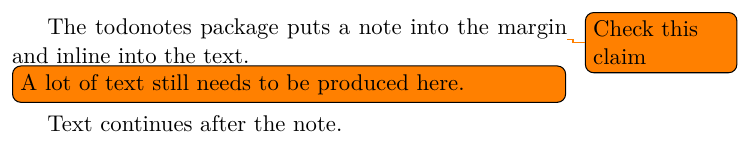
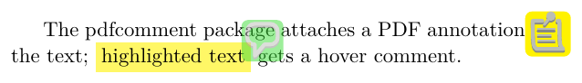
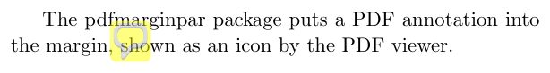
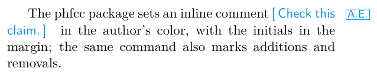

# How to mark TODOs

## Context and Problem Statement

When creating a document, TODOs have to be marked.
How to mark TODO in LaTeX documents?

## Considered Options

- [`todonotes`](https://ctan.org/pkg/todonotes)
- [`pdfcomment`](https://ctan.org/pkg/pdfcomment)
- [`pdfmarginpar`](https://ctan.org/pkg/pdfmarginpar)
- [`phfcc`](https://ctan.org/pkg/phfcc)

Sources and images are in [todo-package/](todo-package/).

## Pros and Cons of the Options

### `todonotes`



Source: [todonotes.tex](todo-package/todonotes.tex)

- Good, because `\todo{...}`, `\missingfigure` and `\listoftodos` give in-text, in-margin and listed TODOs with no PDF-reader dependency.
- Good, because it is widely used and simple to set up.
- Bad, because notes are typeset into the page — they take space and can shift the layout, unlike PDF annotations.

### `pdfcomment`



Source: [pdfcomment.tex](todo-package/pdfcomment.tex)

Needs some configuration:

```latex
\newcommand{\commentontext}[2]{\colorbox{yellow!60}{#1}\pdfcomment[color={0.234 0.867 0.211},hoffset=-6pt,voffset=10pt,opacity=0.5]{#2}}
\newcommand{\commentatside}[1]{\pdfcomment[color={0.045 0.278 0.643},icon=Note]{#1}}
```

- Good, because uses PDF features
- Good, because highlighting of words is not supported

### `pdfmarginpar`



Source: [pdfmarginpar.tex](todo-package/pdfmarginpar.tex)

- Good, because uses PDF features
- Bad, because development stopped.
  Reasons were:
  a) acrobat reader does not allow editing comments made by `pdfcomment`
  b) ideas were incorporated at `pdfcomment`
- Bad, because highlighting of words is not supported
- Bad, because uses GPL as license

### `phfcc`



Source: [phfcc.tex](todo-package/phfcc.tex)

- Good, because `\AE[comment]` is a TODO in the author's color with the initials in the margin, and the same command marks additions and removals (see [How to track changes by several authors](change-tracking.md)).
- Good, because `\phfDisableCommentingCommands` hides all comments for the final version.
- Bad, because comments are typeset into the text and take space, like `todonotes`' inline notes; the `footcomments` style moves them into footnotes.
- Bad, because there is no list of all comments.
