# How to mark TODOs

## Context and Problem Statement

When creating a document, TODOs have to be marked.
How to mark TODO in LaTeX documents?

## Considered Options

- [`easy-todo`](https://ctan.org/pkg/easy-todo)
- [`fixme`](https://ctan.org/pkg/fixme)
- [`fixmetodonotes`](https://ctan.org/pkg/fixmetodonotes)
- [`luatodonotes`](https://ctan.org/pkg/luatodonotes)
- [`pdfcomment`](https://ctan.org/pkg/pdfcomment)
- [`pdfmarginpar`](https://ctan.org/pkg/pdfmarginpar)
- [`phfcc`](https://ctan.org/pkg/phfcc)
- [`smartnotes`](https://ctan.org/pkg/smartnotes)
- [`snaptodo`](https://ctan.org/pkg/snaptodo)
- [`todo`](https://ctan.org/pkg/todo)
- [`todonotes`](https://ctan.org/pkg/todonotes)
- [`zebra`](https://ctan.org/pkg/zebra)

Sources and images are in [todo-package/](todo-package/).
For changes requested by the reviewers of a journal, see [How to mark the changes of a revised manuscript](journal-revisions.md).

## Pros and Cons of the Options

### `easy-todo`

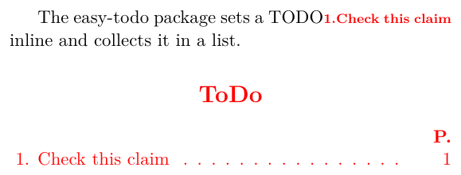

Source: [easy-todo.tex](todo-package/easy-todo.tex)

- Good, because it is small: `\todo` sets the note inline, `\listoftodos` lists them, and `obeyFinal` hides them for `\documentclass[final]`.
- Bad, because the notes are plain colored text in the line, without a margin marker.
- Bad, because the last release is from 2014, and it loads `tocloft`, which changes the lists of figures and tables and is not meant for KOMA-Script classes.

### `fixme`

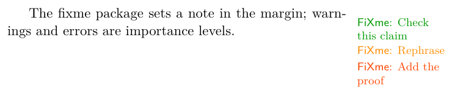

Source: [fixme.tex](todo-package/fixme.tex)

- Good, because notes have importance levels (`\fxnote`, `\fxwarning`, `\fxerror`, `\fxfatal`): in `final` mode, notes, warnings, and errors disappear, and a remaining `\fxfatal` stops the compilation, so an unfinished document cannot be shipped by accident.
- Good, because the layout is selectable: inline, margin, footnote, or as PDF annotation (`\fxsetup{layout=pdfmargin}` uses `pdfcomment`); `\listoffixmes` lists all notes.
- Good, because notes can be assigned to authors (`\FXRegisterAuthor`) and can mark a text range (`\fxnote*{note}{text}`).
- Bad, because the last release is from 2019.
- Bad, because the default margin layout uses `\marginpar`, which TeX forbids in captions and footnotes; the `innerlayout` option has to switch to another layout there.

### `fixmetodonotes`

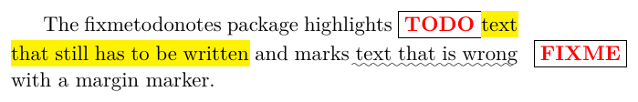

Source: [fixmetodonotes.tex](todo-package/fixmetodonotes.tex)

- Good, because `\TODO{...}`, `\FIXME{...}`, and `\CITE{...}` (text that needs a citation) mark the text itself, and `\defnote` defines further kinds; the `watermark` option prints "DRAFT" on every page.
- Bad, because it needs `hyperref` (it uses `\phantomsection`) and loads many packages (`tocloft`, `watermark`, `transparent`, `ulem`).
- Bad, because the last release is from 2013.

### `luatodonotes`

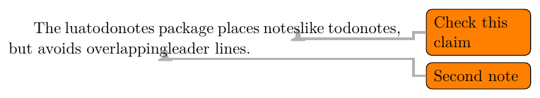

Source: [luatodonotes.tex](todo-package/luatodonotes.tex)

- Good, because it is a drop-in replacement for `todonotes`: the same `\todo`, `\missingfigure`, and `\listoftodos`, only the `\usepackage` line changes.
- Good, because it places the notes with algorithms in Lua, so notes and leader lines do not overlap, and notes in floats and footnotes are placed as well.
- Bad, because it works with LuaLaTeX only; a document that is also compiled with pdfLaTeX needs `todonotes` as fallback.
- Bad, because it is based on `todonotes` 1.0.2, so options added to `todonotes` later are missing.
- Bad, because it needs two or three runs to place the notes, and the placement can take noticeably longer than with `todonotes`.

### `pdfcomment`

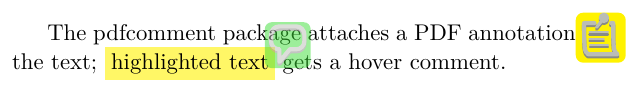

Source: [pdfcomment.tex](todo-package/pdfcomment.tex)

Needs some configuration:

```latex
\newcommand{\commentontext}[2]{\colorbox{yellow!60}{#1}\pdfcomment[color={0.234 0.867 0.211},hoffset=-6pt,voffset=10pt,opacity=0.5]{#2}}
\newcommand{\commentatside}[1]{\pdfcomment[color={0.045 0.278 0.643},icon=Note]{#1}}
```

- Good, because uses PDF features
- Good, because highlighting of words is not supported

### `pdfmarginpar`

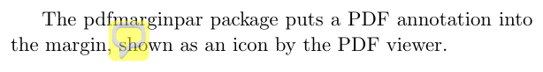

Source: [pdfmarginpar.tex](todo-package/pdfmarginpar.tex)

- Good, because uses PDF features
- Bad, because development stopped.
  Reasons were:
  a) acrobat reader does not allow editing comments made by `pdfcomment`
  b) ideas were incorporated at `pdfcomment`
- Bad, because highlighting of words is not supported
- Bad, because uses GPL as license

### `phfcc`

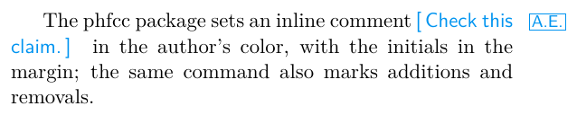

Source: [phfcc.tex](todo-package/phfcc.tex)

- Good, because `\AE[comment]` is a TODO in the author's color with the initials in the margin, and the same command marks additions and removals (see [How to track changes by several authors](change-tracking.md)).
- Good, because `\phfDisableCommentingCommands` hides all comments for the final version.
- Bad, because comments are typeset into the text and take space, like `todonotes`' inline notes; the `footcomments` style moves them into footnotes.
- Bad, because there is no list of all comments.

### `smartnotes`

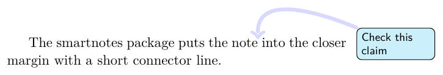

Source: [smartnotes.tex](todo-package/smartnotes.tex)

- Good, because `\note{...}` puts the note into the closer margin with a short connector, and the `disable` option hides all notes.
- Bad, because it is a first release (0.1 from 2026) with basic overlap avoidance only.
- Bad, because there is no list of all notes, and `\note` is a generic name that other packages define, too.

### `snaptodo`


Source: [snaptodo.tex](todo-package/snaptodo.tex)

- Good, because `\snaptodo{...}` puts the note into the margin closer to where it is called, and notes and their lines never overlap.
- Good, because the style is set with TikZ keys (`\snaptodoset`).
- Bad, because it needs a wide margin on both sides; with a narrow inner margin, notes there are cut off.
- Bad, because there is no list of all notes and no option to hide the notes for the final version.

### `todo`

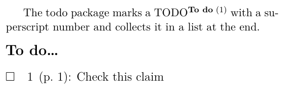

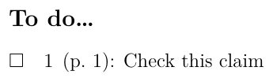

Source: [todo.tex](todo-package/todo.tex)

- Good, because the marks do not change the layout (`\todo*` and the option `nothing` hide them), and `\done` checks an item off in the list.
- Bad, because the text of a TODO is only in the list at the end (`\todos`), not where the TODO is, unless `\Todo` is used.
- Bad, because the last release is from 2010.

### `todonotes`

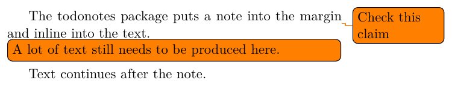

Source: [todonotes.tex](todo-package/todonotes.tex)

- Good, because `\todo{...}`, `\missingfigure` and `\listoftodos` give in-text, in-margin and listed TODOs with no PDF-reader dependency.
- Good, because it is widely used and simple to set up.
- Bad, because notes are typeset into the page — they take space and can shift the layout, unlike PDF annotations.

### `zebra`

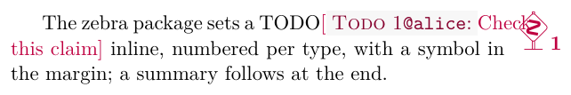

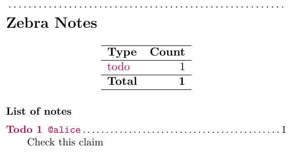

Source: [zebra.tex](todo-package/zebra.tex)

- Good, because notes are short inline text with a small numbered symbol in the margin, so the margin stays readable and nothing overlaps.
- Good, because five note types (`\todo`, `\note`, `\comment`, `\fixed`, `\placeholder`) are numbered per type, can name who is responsible (`\todo[alice]{...}`), and `\zebranewnote` defines further types.
- Good, because a summary table and a list of all notes, linked to the notes when `hyperref` is loaded, are appended at the end; the `final` option removes notes and lists.
- Good, because it is maintained (version 2.1.0 from 2026) and places the symbol in the nearer margin in two-column documents.
- Bad, because the notes stand in the text and take space, like the inline notes of `todonotes`.
- Bad, because short names that another package already defines (`\todo` of `todonotes`, `\comment` of `mindflow` or `changes`) are not redefined; then only the prefixed form (`\zebratodo`) works.
