# How to draw UML diagrams

## Context and Problem Statement

Theses and papers contain UML diagrams: class diagrams, sequence diagrams,
component diagrams. They should be written as text next to the LaTeX source
(diffable, no image files to keep in sync) and use the fonts of the document.
Ideally, they compile without extra tools and without `--shell-escape`, so that
the template works out of the box locally, in Docker, on Overleaf, and in CI.
How should UML diagrams be drawn?

## Considered Options

- [PlantUML](https://plantuml.com/) via the [plantuml](https://ctan.org/pkg/plantuml) package
- [MetaUML](https://ctan.org/pkg/metauml) (MetaPost)
- [pst-uml](https://ctan.org/pkg/pst-uml) (PSTricks)
- [pgf-umlcd](https://ctan.org/pkg/pgf-umlcd) and [pgf-umlsd](https://ctan.org/pkg/pgf-umlsd) (TikZ)
- [tikz-uml](https://perso.ensta-paris.fr/~kielbasi/tikzuml/) (TikZ, not part of TeX Live)
- [uml](https://ctan.org/pkg/uml) (PSTricks)
- drawing with an external tool (e.g., draw.io) and including the PDF

## Comparison

The minimal working examples (MWEs) are the diagrams of the examples of the [plantuml package](https://github.com/koppor/plantuml).
Each diagram is rebuilt with every package that supports the diagram type.
tikz-uml is taken from its [git repository](https://plmlab.math.cnrs.fr/tikzuml/tikzuml) (commit 4d6aaba of 2026-05-28).
Sources and images are in [uml-diagrams/](uml-diagrams/).
All LaTeX sources were compiled with LuaLaTeX of TeX Live 2026 *without* `--shell-escape`; the PlantUML images were rendered by PlantUML 1.2026.8.

| MWE | PlantUML (reference) | MetaUML | pgf-umlcd / pgf-umlsd | pst-uml | tikz-uml |
| -- | -- | -- | -- | -- | -- |
| Sequence | 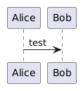 | not supported | 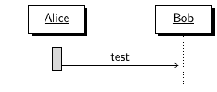 | not supported | 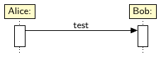 |
| Class relations | 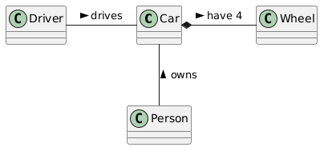 | 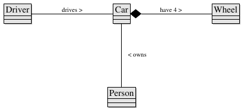 | 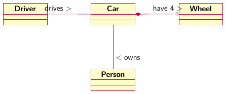 | 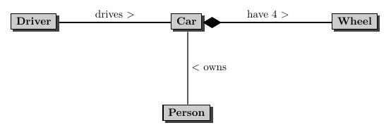 | 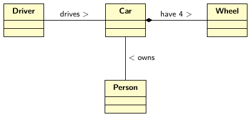 |
| Class visibility | 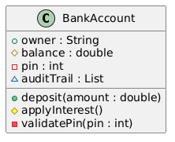 | 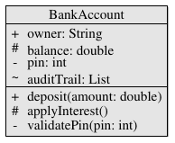 | 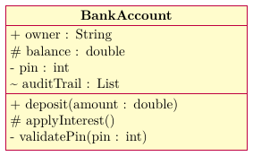 | 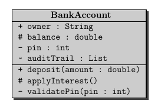 | 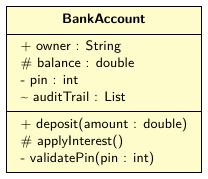 |
| Components | 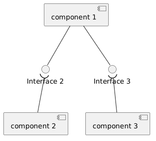 | 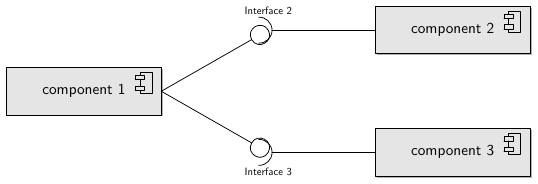 | not supported | not supported | 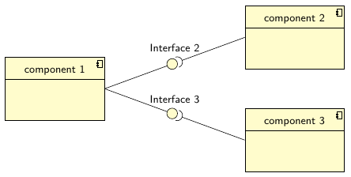 |

| | LuaLaTeX | pdfLaTeX |
| -- | -- | -- |
| PlantUML | `--shell-escape`, Java, PlantUML | `--shell-escape`, Java, PlantUML |
| MetaUML | built in ([luamplib](https://ctan.org/pkg/luamplib)) | `--shell-escape` ([gmp](https://ctan.org/pkg/gmp)) |
| pgf-umlcd / pgf-umlsd | works | works |
| pst-uml | built in ([luapstricks](https://ctan.org/pkg/luapstricks)) | `--shell-escape` ([auto-pst-pdf](https://ctan.org/pkg/auto-pst-pdf)) |
| tikz-uml | works | works |

## Syntax

Lines of diagram code per MWE (without preamble, comments, and blank lines):

| MWE | PlantUML | MetaUML | pgf-umlcd | pgf-umlsd | pst-uml | tikz-uml |
| -- | -- | -- | -- | -- | -- | -- |
| Sequence | 1 | not supported | not supported | 5 | not supported | 6 |
| Class relations | 4 | 13 | 7 | not supported | 7 | 7 |
| Class visibility | 9 | 2 (all members in one line) | 9 | not supported | 8 | 5 |
| Components | 9 | 15 | not supported | not supported | not supported | 8 |

PlantUML lays out the diagram automatically (via Graphviz), and a relation is a single arrow such as `Car *- Wheel : have 4 >`.
All other packages need positions: coordinates (pgf-umlcd, pst-uml, tikz-uml) or offsets relative to other objects (MetaUML, e.g., `cTwo.w = cOne.e + (140, 40)`); MetaUML also needs the positions of the labels.

## Customization

### Sans-serif font

All MWEs above are typeset in a sans-serif font:

- MetaUML: `\mplibtextextlabel{enable}` lets TeX typeset all labels in the current font; `\sffamily` before `mplibcode` switches to sans serif. Without it, MetaUML uses Times (`metauml_defaultFont`).
- pgf-umlcd: `\begin{tikzpicture}[font=\sffamily]`; pgf-umlsd: `\sffamily` before `sequencediagram`.
- pst-uml: `\renewcommand{\familydefault}{\sfdefault}`, because `\umlClass` sets the class name in `\normalfont`; the members stay in typewriter font.

### Hiding the members of a class

- MetaUML: `EClass.Car(iClassNameOnly)("Car")()();` (or `ClassName.Car("Car");`). MetaUML still draws the lines of the (empty) compartments; redefining `Class_paintSkin` omits them (see [class-relations--name-only--metauml.tex](uml-diagrams/class-relations--name-only--metauml.tex)). A small empty space below the name remains:

  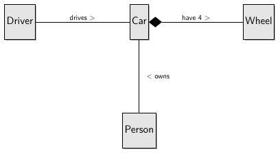
- pgf-umlcd: an empty `class` environment still shows the empty compartments.
- pst-uml: `\umlClass{Car}{}` shows the name only.

## Pros and Cons of the Options

### PlantUML

- Good, because the diagrams are written in a compact text notation and laid out automatically.
- Good, because it supports all diagram types of UML (and more, e.g., mind maps).
- Bad, because it needs Java, PlantUML (and Graphviz for some diagrams), and `--shell-escape`.
- Bad, because neither the Docker image of TeX Live nor Overleaf ship PlantUML.

### MetaUML

- Good, because LuaLaTeX runs MetaPost itself ([luamplib](https://ctan.org/pkg/luamplib), `\begin{mplibcode}`): no external tool, no `--shell-escape`.
- Good, because the result is closest to PlantUML: correct UML arrow heads (triangle, diamonds) and labels on the lines.
- Good, because with `\mplibtextextlabel{enable}` the labels are typeset by TeX in the font of the document.
- Good, because it supports class, package, component (with provided and required interfaces), use case, activity, and state diagrams.
- Neutral, because the layout is given by relations between the objects (e.g., `leftToRight(90)(A, B)`: 90 PostScript points between the boxes), not by coordinates.
- Neutral, because hiding the members of a class (`iClassNameOnly`) leaves the compartment lines unless `Class_paintSkin` is redefined.
- Bad, because it does not support sequence diagrams.
- Bad, because with pdfLaTeX it needs [gmp](https://ctan.org/pkg/gmp) and `--shell-escape` (without it, `gmp` shows a placeholder).
- Bad, because MetaPost syntax is unfamiliar to most LaTeX users (e.g., `c1` is the array element `c[1]` and cannot be used as name).

### pgf-umlcd and pgf-umlsd

- Good, because they are pure TikZ: they work with every engine, without `--shell-escape`.
- Good, because pgf-umlsd is the only package here that draws sequence diagrams.
- Neutral, because the default colors (yellow boxes, red lines) need to be changed for a plain look.
- Bad, because pgf-umlcd places association names at the ends of the lines (role names), not in the middle.
- Bad, because the boxes are placed by coordinates and have a fixed default width, so boxes overlap unless widths are set (e.g., `text width=1.6cm`).
- Bad, because pgf-umlcd does not support component diagrams.

### pst-uml

- Good, because LuaLaTeX runs PSTricks itself since [luapstricks](https://ctan.org/pkg/luapstricks) (TeX Live 2022): no `--shell-escape`. XeLaTeX supports PSTricks natively.
- Good, because the UML arrow heads (inheritance, aggregation, composition) are available as icons on the connections (`\ncputicon{umlCompos}`).
- Neutral, because the boxes are placed by coordinates (`\rput`) and connected via [pst-node](https://ctan.org/pkg/pst-node) (`\rnode`, `\ncline`).
- Bad, because it supports only class, use case, and state diagrams; no sequence and component diagrams.
- Bad, because the documentation is in French and the package (version 0.83) is no longer developed.
- Bad, because pdfLaTeX cannot run PSTricks: it needs a workaround (see below) and `--shell-escape`.

#### Running PSTricks with pdfLaTeX: pst-pdf versus pdftricks

Both run `latex`, `dvips`, and `ps2pdf` on the PSTricks pictures and include the resulting PDF.

- [pst-pdf](https://ctan.org/pkg/pst-pdf) with [auto-pst-pdf](https://ctan.org/pkg/auto-pst-pdf): Good, because `auto-pst-pdf` runs the extra steps automatically (with `--shell-escape`); it is the common way.
- [pdftricks](https://ctan.org/pkg/pdftricks): Bad, because it needs the pictures in special environments and offers nothing beyond `pst-pdf`.
- Both are not needed with LuaLaTeX (luapstricks) or XeLaTeX.

### tikz-uml

- Good, because it is pure TikZ: it works with every engine, without `--shell-escape`.
- Good, because it covers all diagram types of the comparison: class, component (with provided and required interfaces), and sequence diagrams; also use case and state diagrams.
- Good, because it is actively developed.
- Neutral, because the boxes are placed by coordinates (`x=`, `y=`).
- Neutral, because the default colors (yellow boxes) need to be changed for a plain look.
- Bad, because it is not part of TeX Live (nor CTAN); it has to be added, e.g., as git submodule (which Overleaf does not fetch).

### uml

- Bad, because it is based on PSTricks (same engine restrictions as pst-uml) and no longer developed.
- Not tested.

### External tool

- Good, because any diagram type and layout is possible.
- Bad, because the diagram is a binary file that is not diffable and easily gets out of sync with the text.
- Bad, because the fonts of the diagram differ from the document.

## More Information

[uml-diagrams/regenerate.sh](uml-diagrams/regenerate.sh) regenerates all images from the sources (`lualatex`, then `pdftoppm -r 110`; `plantuml -tpng` for the PlantUML references).
Its header shows how to run LuaLaTeX in the TeX Live Docker image.
